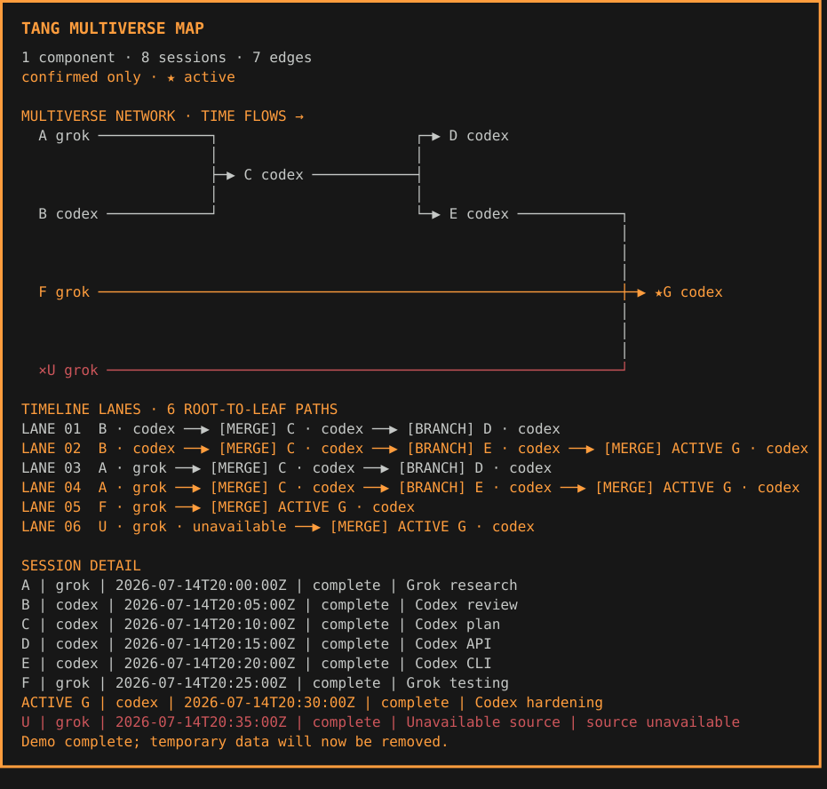
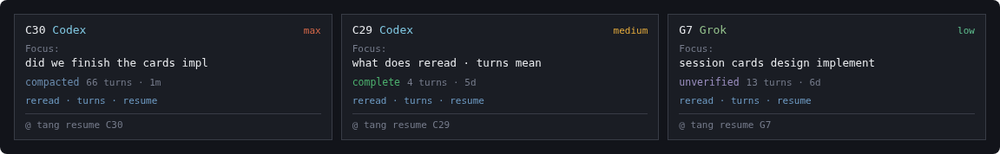

# Tang

<table>
<tr>
<td width="68%" valign="top">

**Keep the blade, switch the handle.**

**Continue one coding agent's work inside another, with the original sources cited.**

Tang is a local Rust CLI. It indexes coding-agent sessions, searches them, and records only the continuations you confirm. The Multiverse Map is that confirmed graph.

Supported readers: Codex, Grok, OpenCode, Cursor, Claude Code, Antigravity, and OpenClaw. Native logs stay read-only. Tang stores derived data in `.tang/tang.db` and, when you sync, a global catalog at `~/.tang/catalog.db`.

</td>
<td width="32%" align="right" valign="top">

</td>
</tr>
</table>

## The Multiverse Map

Every edge is a continuation you confirmed. Several sources can merge into one session, and that session can later branch. Tang does not invent the relationships.

```text
  A grok ─────────────┐                       ┌─▶ D codex
                      │                       │
                      ├─▶ C codex ────────────┤
                      │                       │
  B codex ────────────┘                       └─▶ E codex ────────────┐
                                                                      │
  F grok ─────────────────────────────────────────────────────────────┼─▶ ★G codex
                                                                      │
  ×U grok ────────────────────────────────────────────────────────────┘
```

`U` is present in the graph and unavailable as a native source, so it cannot start a new edge. `G` is the active handle.



That card is the real `tang demo --svg --width 120` output. Regenerate it from a checkout with:

```bash
cargo run --manifest-path rust/Cargo.toml -- demo --svg --width 120 \
  --output docs/assets/tang-multiverse-demo.svg
```

Per-harness capabilities are listed in [`docs/harness-matrix.md`](docs/harness-matrix.md).

## Build

```bash
cargo build --manifest-path rust/Cargo.toml --release
./rust/target/release/tang --help
cargo test --manifest-path rust/Cargo.toml
```

Linux is the tested platform. This tree makes no macOS or Windows claim.

## Commands

| Command | What it does |
|---|---|
| `tang index` | Read native sessions for the current project into `.tang/tang.db` |
| `tang browse` / `tang cards` | List project sessions. `--cards` prints cards. Filters: `--harness`, `--health`, `--since`, `--until`, `--include-unavailable` |
| `tang search QUERY` | Search this project's capsules. Same filters as browse. Does not open native logs |
| `tang catalog sync` | Copy redacted capsules into the global catalog |
| `tang recall [QUERY]` | Search the global catalog. Filters: `--label`, `--category`, `--harness` |
| `tang label add\|remove HANDLE LABEL` | Attach or remove an operator tag |
| `tang context HANDLE...` | Reread the selected native sources, redact them, and cite the pack. A missing or symlinked source keeps the stored capsule |
| `tang context all --for HANDLE` | Pack the confirmed predecessors of a session |
| `tang join` / `tang link` | Record a same-project continuation. `--into HANDLE` or `--current --current-native-id ID` |
| `tang title HANDLE TITLE` | Set a custom title. `--clear` restores the previous one |
| `tang graph [HANDLE]` | Render the Multiverse Map. `tang map` is the same command |
| `tang demo` | Print an isolated map. It does not create a database or read native logs |
| `tang resume HANDLE` | Launch the native harness for a project handle |
| `tang doctor` | Check that SQLite and FTS5 are usable |
| `tang continuity` | Show the git branch and indexed session count |
| `tang skill install codex\|claude\|opencode` | Copy the bundled skill into a home you pass with `--cwd` |
| `tang stats` | Count sessions, harnesses, categories, labels, edges, and components |
| `tang purge --all --yes` | Delete this project's derived rows. Native logs stay |

`--json` prints `schema_version: 1` where a command has a machine-readable form. `--ascii` forces ASCII connectors on the map and cards.

```bash
tang index --codex-home ~/.codex --grok-home ~/.grok
tang catalog sync
tang recall "cache boundary"
tang label add C2 release
tang join --from C1 --from G1 --into C2
tang graph
tang demo --ascii
```

A harness is scanned only when its home flag is set, except Codex, which is the default when you pass no harness flag.

## Session cards

`tang cards` and `tang browse --cards` print one card per indexed session: handle, harness, health, time, and title.



## Privacy

- Project database mode is `0600`. The catalog is created only by `tang catalog sync`.
- Capsules hold at most 8 KiB of redacted visible text.
- Secrets, tokens, and home paths are redacted before they are stored or shown.
- `tang recall` and `tang search` read derived databases, not native logs.
- Joins that would cross projects are refused.
- `tang purge` does not delete native logs.

The v1 specification remains [`docs/tangspec.md`](docs/tangspec.md). The 2.0 plan is [`docs/tang-2.0.md`](docs/tang-2.0.md).

## License

[MIT](LICENSE). Report security issues privately using [SECURITY.md](SECURITY.md). Do not attach native transcripts or credentials.

**Keep the blade, switch the handle.**
